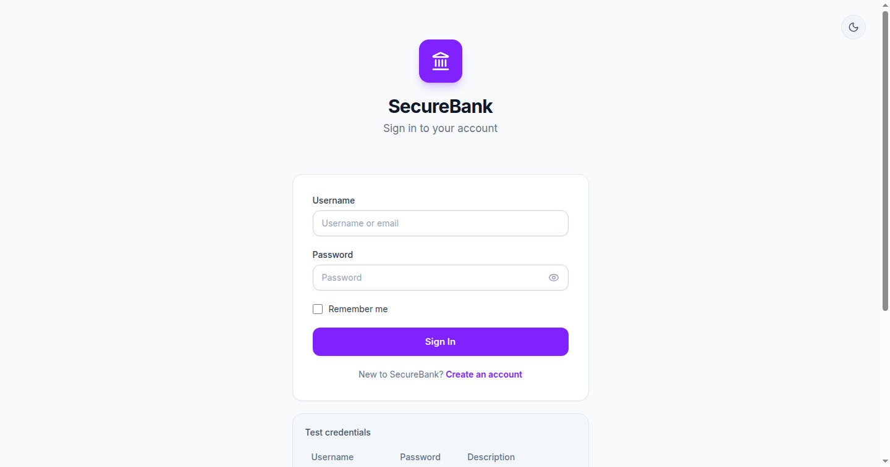
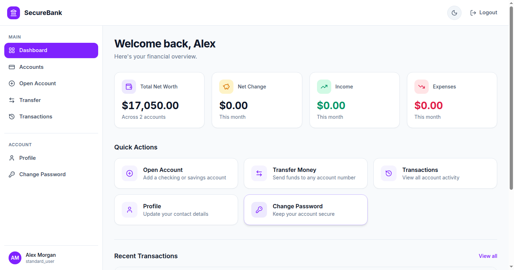
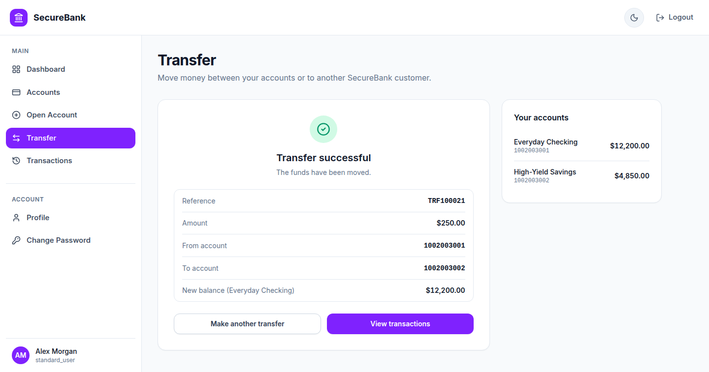
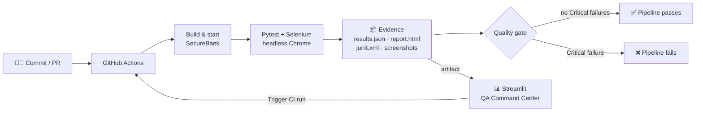

<div align="center">

# 🏦 BankTest

### Continuous QA & regression testing for a banking web app

Every commit builds the app, drives it with **Selenium**, enforces a **quality gate** in **GitHub Actions**, and shows the results on a **Streamlit** dashboard.

[](https://github.com/Adnan-Safdari/qa-playground-testing/actions/workflows/selenium-tests.yml)


*Built for the **Seleniverse 2.0** software-testing hackathon.*

</div>

---

## 📖 Overview

**BankTest** is a regression-testing pipeline for **SecureBank**, a demo online-banking app that lives in the same repository. Because the app and its tests share one repo, a code change and the tests that guard it are reviewed and run together in the same pull request.

| | |
|---|---|
| 🏦 **SecureBank** | Next.js banking app: registration, login, accounts, money transfers, transaction history, profile and password management |
| 🧪 **Test suite** | **33** Selenium + Pytest end-to-end tests using the Page Object Model: 29 regression tests (**6 Critical**) plus 4 known-defect tests that fail on purpose |
| ⚙️ **CI pipeline** | GitHub Actions builds and starts the app, runs headless Chrome, uploads the evidence and applies a quality gate |
| 📊 **QA Command Center** | Streamlit dashboard showing run history, pass-rate trends, **bug reports with screenshots**, and one-click test runs (headless or in a visible browser) |

> [!NOTE]
> SecureBank is a **demo environment**. No real money, accounts or personal data are involved. All data lives in the browser.

---

## 📸 Screenshots

<table>
  <tr>
    <td width="50%"><p align="center"><sub><b>Login</b>: test credentials are listed on the page</sub></p></td>
    <td width="50%"><p align="center"><sub><b>Dashboard</b>: net worth, monthly stats, quick actions</sub></p></td>
  </tr>
  <tr>
    <td colspan="2"><p align="center"><sub><b>Money transfer</b>: reference number and updated balances</sub></p></td>
  </tr>
</table>

---

## 🔄 How it works



1. A **push or pull request to `main`** starts the workflow. It can also be started manually, and it runs every night.
2. CI tests **the exact commit that was pushed**, never a public demo site. It builds the Next.js app, starts it and waits until it responds.
3. Pytest drives **headless Chrome** through every test case. Each test gets a fresh browser, so tests never share data.
4. Every run produces **evidence**: a JSON results file, an HTML report, JUnit XML, and a full-page screenshot for every failure.
5. The **quality gate** fails the pipeline if any **Critical** test fails.
6. The **dashboard** pulls each run in from GitHub and keeps the history in SQLite, because GitHub deletes artifacts after 30 days.

---

## ✨ Features

- **Tests check the money, not just the success message.** They read exact integer-cent balances from `data-cents` attributes. They verify that the sender is debited, the recipient is credited and the combined total is unchanged.
- **Stable selectors.** Every element the tests use has a stable `id` and `data-testid`. Routes, selectors and exact error messages are fixed in a shared [app contract](testing/APP_CONTRACT.md).
- **Page Object Model.** All selectors live in [`testing/pages/`](testing/pages), so a UI change means editing one file.
- **Explicit waits only.** No `time.sleep()` and no implicit waits. `slow_user` deliberately delays every page to prove it.
- **Traceable results.** Every test is tagged with its test-case ID (`@pytest.mark.testcase("SB-TR-01")`), and every run records its commit, branch and workflow run.
- **Evidence on failure.** Every failure gets a full-page screenshot and a tracker-ready **bug report**: steps to reproduce, expected vs actual result, environment, build, page URL, browser console errors and the stack trace (`testing/reports/bug_reports/<TC-ID>.md` and the dashboard's **Bug Reports** tab).
- **Run tests from the dashboard.** Run the suite headless, **watch it in a visible Chrome window**, or trigger a CI run on GitHub. You can run everything or pick one module.

---

## 🧰 Tech stack

| Layer | Technology |
|---|---|
| App under test | Next.js 16 (App Router) · React 19 · Tailwind CSS · browser storage (no backend) |
| Browser automation | Selenium WebDriver 4 · Chrome (driver provided by Selenium Manager) |
| Test framework | Pytest 9 · pytest-html · custom results plugin |
| CI/CD | GitHub Actions |
| Dashboard | Streamlit · Plotly · pandas · SQLite |

---

## 🗂️ Repository structure

```
.
├── app/(bank)/bank/          SecureBank pages (login, register, dashboard, accounts, transfer, …)
├── lib/bankStorage.js        Data layer: seeded users, business rules, all validation
├── testing/                  Selenium + Pytest suite
│   ├── APP_CONTRACT.md       Routes, selectors, exact messages, report formats
│   ├── pages/                Page Object Model (one class per page)
│   ├── tests/                One test file per module
│   ├── test_data/            Users, customers, transfer data, expected messages
│   ├── utils/                Results plugin (results.json, screenshots)
│   ├── scripts/quality_gate.py
│   └── test_cases.json       Manual test-case catalogue (29 cases)
├── dashboard/                Streamlit QA Command Center
│   ├── app.py                UI
│   ├── ingest.py             Local and GitHub-artifact ingestion (CLI too)
│   ├── runner.py             "Run all tests" and "Trigger CI run"
│   └── storage.py            SQLite run history
├── .github/workflows/selenium-tests.yml
├── .env.example              Template for local settings
└── PROJECT_CONTEXT.md        Full project brief
```

---

## 🚀 Quick start

### Prerequisites

- **Node.js 20.9+** and npm
- **Python 3.12**
- **Google Chrome** (Selenium Manager downloads the matching driver)

### 1. Configure

```bash
cp .env.example .env      # then paste your GitHub token into .env (optional, see below)
```

| Variable | Default | Used by |
|---|---|---|
| `GITHUB_TOKEN` | — | Dashboard: sync results from GitHub and trigger CI runs |
| `GITHUB_REPOSITORY` | `Adnan-Safdari/qa-playground-testing` | Dashboard |
| `BASE_URL` | `http://localhost:3000` | Tests and dashboard |
| `HEADLESS` | `1` | Tests (`0` opens a visible browser) |

`.env` is git-ignored. Variables already set in your shell take precedence over it.

### 2. Run SecureBank

```bash
npm install
npm run build && npm start        # http://localhost:3000  (use `npm run dev` while developing)
```

Sign in with **`standard_user` / `bank_sauce`**, or create a new customer at `/bank/register`.

### 3. Run the tests

```bash
cd testing
python3 -m venv .venv && .venv/bin/pip install -r requirements.txt

.venv/bin/pytest                         # all 33 tests, headless (4 known defects fail by design)
.venv/bin/pytest -m "not known_defect"   # the 29 regression tests only
HEADLESS=0 .venv/bin/pytest -k transfer  # watch the transfer tests run
.venv/bin/pytest -m critical             # only the 6 Critical tests
.venv/bin/python scripts/quality_gate.py # apply the CI quality gate locally
```

Reports are written to `testing/reports/`; open `report.html` in a browser.

### 4. Open the dashboard

```bash
cd dashboard
python3 -m venv .venv && .venv/bin/pip install -r requirements.txt
cd .. && dashboard/.venv/bin/streamlit run dashboard/app.py    # http://localhost:8501
```

Press **▶ Run tests** (headless) or **👁 Watch in browser** (visible Chrome), optionally for a single module, or ingest an existing run with `dashboard/.venv/bin/python dashboard/ingest.py local`.

---

## 👥 Test users

All seeded users share the password **`bank_sauce`**. Each one exercises a different behaviour.

| Username | Behaviour | Used for |
|---|---|---|
| `standard_user` | Full access, two accounts ($12,450.00 + $4,600.00) | Happy-path flows |
| `locked_user` | Login is rejected | Negative authentication |
| `frozen_user` | Every transfer is rejected | Business-rule enforcement |
| `overdraft_user` | Starts with a negative balance | Insufficient-funds checks |
| `slow_user` | Every page loads after a 2.5 s delay | Explicit-wait robustness |

Customers created through **Create Account** sign in with their email address.

---

## 🧪 Test coverage

**33 automated test cases**: 29 regression tests across 7 modules (**6 Critical · 12 High · 11 Medium**) plus **4 known-defect tests**. The full catalogue, with objectives, preconditions, test data, steps and expected results, is in [`testing/test_cases.json`](testing/test_cases.json).

| Module | Test cases | What's covered |
|---|---|---|
| **Open Application** | `SB-OP-01` ★ · `02` · `03` | App loads (HTTP 200 and title), login controls present, invalid URL returns 404 |
| **Create New Account** | `SB-AC-01` ★ · `02` · `03` · `04` · `05` | Valid registration with balance check, required fields, invalid email, weak password, duplicate email |
| **Money Transfer** | `SB-TR-01` ★ · `02` · `03` · `04` · `05` · `06` · `07` · `08` | $500 transfer with both balances verified, insufficient balance, unknown recipient, zero and negative amounts, required fields, transaction history, frozen account |
| **Authentication** | `SB-AU-01` ★ · `02` · `03` · `04` | Valid login, wrong password, locked user, slow-loading user |
| **Logout** | `SB-LO-01` · `02` ★ | Logout confirmation, protected pages blocked after logout |
| **Profile** | `SB-PR-01` · `02` · `03` | Profile update persists, invalid email, required fields |
| **Change Password** | `SB-PW-01` ★ · `02` · `03` · `04` | Full flow (old password rejected, new one accepted), wrong current password, mismatched confirmation, weak new password |
| **Known Defects** 🐞 | `SB-KD-01` · `02` · `03` · `04` | Requirements SecureBank doesn't meet yet, so these **fail on purpose**: no lockout after 3 failed logins, no transfer confirmation step, unmasked account numbers, "Across 1 accounts" grammar bug |

★ = **Critical**. A failure in any of these fails the pipeline. The known-defect tests are not Critical, so they show up as bug reports without blocking CI. Exclude them with `-m "not known_defect"`.

<details>
<summary><b>Example: SB-TR-01 (Successful money transfer)</b></summary>

| | |
|---|---|
| **Preconditions** | Two customers registered in the test, each with a $5,000.00 opening deposit |
| **Steps** | Log in as A → Transfer → from A's account to B's account number → $500 → submit |
| **Expected** | Success panel with a `TRF…` reference · A = **$4,500.00** · B = **$5,500.00** (checked by logging in as B) · combined total unchanged at $10,000.00 |
| **Verified via** | `data-cents` attributes, not only the text on screen |

</details>

---

## ⚙️ CI/CD pipeline

Workflow: [`.github/workflows/selenium-tests.yml`](.github/workflows/selenium-tests.yml)

| Trigger | When |
|---|---|
| `push` | Every commit to `main` |
| `pull_request` | Every PR targeting `main` |
| `workflow_dispatch` | Manually from the Actions tab or the dashboard's **Trigger CI run** (optional `min_pass_rate` input) |
| `schedule` | Nightly regression at 02:00 UTC |

**Stages:** checkout → Node 20 + `npm ci` → `npm run build` → start the app and wait until it responds → Python 3.12 + test dependencies → **pytest** → upload the **`test-results`** artifact (reports, screenshots, server log; kept 30 days) → **quality gate**.

A newer commit on the same branch cancels the run still in progress.

### Quality gate

[`testing/scripts/quality_gate.py`](testing/scripts/quality_gate.py) runs after every test run, even when tests fail. It **fails the pipeline** if:

- any **Critical** test fails or errors,
- the pass rate is below `MIN_PASS_RATE` (off by default; set it to `100` to fail on any failure), or
- the run crashed or produced no results.

Failures in High, Medium or Low tests leave the pipeline green but are listed in the job summary, the report and the dashboard.

---

## 📊 QA Command Center (Streamlit)

<table>
<tr><td>

**Dashboard tab**
- Latest-run status badge, commit, branch and time since the run
- Cards for total cases, pass rate, failed, critical failures, average duration and last run, each with the change since the previous run
- Quality-gate panel naming the Critical tests that failed
- Outcome donut, failures by module, pass-rate trend
- **Needs attention**: failing tests with message, traceback and screenshot

</td><td>

**Other tabs**
- **🐞 Bug Reports**: failure-screenshot gallery plus a full bug report for every failure (details table, steps, expected vs actual, console errors, stack trace, `.md` download)
- **Test Management**: catalogue filterable by module, priority and latest status
- **Execution Details**: per-run results, failure evidence, downloadable reports
- **History & Analytics**: trends, most frequently failing tests, flaky and recovered patterns, duration over time

**Actions**
- ▶ **Run tests**: runs the suite (or one module) headless against `BASE_URL` with live output, then saves the results automatically
- 👁 **Watch in browser**: the same, with a visible Chrome window
- ☁ **Trigger CI run**: starts the GitHub workflow
- ⟳ **Sync from GitHub**: imports CI runs and their artifacts

</td></tr>
</table>

### GitHub token

**Sync from GitHub** and **Trigger CI run** need a token:

1. Go to **GitHub → Settings → Developer settings → Personal access tokens → [Fine-grained tokens](https://github.com/settings/personal-access-tokens/new)**.
2. Under repository access, select only this repository and set **Actions: Read and write**.
3. Paste it into `.env` as `GITHUB_TOKEN=github_pat_…` and restart the dashboard.

Never commit the token. `.env` and `.streamlit/secrets.toml` are both git-ignored.

---

## 🐞 Regression demo: catching a bug

How BankTest catches a regression end to end:

1. **Green baseline.** Run `pytest -m "not known_defect"`; all 29 regression tests pass and the gate is ✅.
2. **Introduce a deliberate bug** on a branch. In [`lib/bankStorage.js`](lib/bankStorage.js), short-change the recipient of a transfer:
   ```js
   to.balance += cents - 100; // DEMO BUG (intentional): recipient loses $1
   ```
3. **Open a pull request.** GitHub Actions starts automatically.
4. **Selenium detects it.** `SB-TR-01` fails because the recipient has $5,499.00 instead of $5,500.00. The screenshot and assertion are captured, and the **quality gate fails the PR**.
5. **Investigate.** Press **Sync from GitHub** in the dashboard to see the failure, the error and the screenshot.
6. **Fix it.** Revert the change and push. CI is green again and the dashboard shows the test as *Recovered*.

> [!IMPORTANT]
> The bug is introduced **only for demonstration**, on a branch, and reverted afterwards.

---

## 🧭 Design decisions

- **One repository.** The app, its tests and the pipeline are versioned together, so every commit is tested against its own code.
- **The contract comes first.** [`APP_CONTRACT.md`](testing/APP_CONTRACT.md) fixes the routes, selectors, error messages and report schema. The UI, the tests and the dashboard were built against it in parallel.
- **Money in integer cents.** No floating-point drift, and tests can assert exact balances.
- **Isolated, repeatable tests.** App state lives in browser storage and every test starts a fresh browser, so runs don't depend on each other or on earlier runs.
- **Risk-based gating.** Only Critical tests (authentication, transfers, registration, session protection, password change) block the pipeline. The rest are reported without blocking.

---

## ⚠️ Scope & limitations

This is a **hackathon prototype**.

- SecureBank has **no backend**. Data lives in the browser's storage and is reset in each new browser profile. That keeps tests isolated, but nothing is shared between browsers.
- Only **Chrome** is automated.
- Loans and admin views from the original brief are **not implemented**, so they aren't tested.
- **Planned:** Docker images for the app, test runner and dashboard.

---

## 🙏 Credits

SecureBank started from the bank demo in [QA Playground](https://github.com/kundalik5545/qatesting). The repository was stripped down to the banking app and rebuilt for this project.

<div align="center"><sub>Built for <b>Seleniverse 2.0</b> 🧪</sub></div>
